### Діграмма вектора атаки для CTF "Vikings 1", згрупована за тактикама MITRE ATT&CK в хронологічному порядку:

```mermaid
flowchart TD
    subgraph REC[Reconnaissance]
        A1[netdiscover + nmap -sC -sV -p-<br/>T1595 Active Scanning]
        A2[gobuster dir brute force<br/>T1595.003 Wordlist Scanning]
    end

    subgraph DISC1[Discovery]
        B1[Знайдено war.txt / war-is-over<br/>base64 декод в zip-архів<br/>T1083 File and Directory Discovery]
    end

    subgraph CRED1[Credential Access]
        C1[zip2john + john rockyou.txt<br/>T1110.002 Password Cracking]
        C2[binwalk: стеганографія в image<br/>T1552.001 Credentials In Files]
    end

    subgraph INIT[Initial Access]
        D1[SSH вхід як floki<br/>T1078 Valid Accounts /<br/>T1021.004 Remote Services: SSH]
    end

    subgraph CRED2[Credential Access]
        E1[Гіпотеза Коллатца для 109<br/>дешифрування пароля ragnar<br/>T1552.001 Credentials In Files]
    end

    subgraph PRIV1[Privilege Escalation]
        F1[su ragnar<br/>T1078.003 Valid Accounts: Local Accounts]
    end

    subgraph COLL1[Collection]
        G1[Читання user.txt<br/>T1005 Data from Local System]
    end

    subgraph DISC2[Discovery]
        H1[sudo -l — безуспішно<br/>T1069 Permission Groups Discovery]
        H2[Аналіз .profile: rpyc_classic.py<br/>запущений під root<br/>T1518 Software Discovery]
    end

    subgraph PERS[Persistence - підготовка]
        I1[Генерація SSH-ключів Kali +<br/>розміщення pubkey на веб-сервері<br/>T1098.004 SSH Authorized Keys]
    end

    subgraph EXEC[Execution / Exploitation]
        J1[Експлуатація rpyc_classic<br/>teleport getshell: копіювання<br/>authorized_keys у /root/.ssh<br/>T1059.006 Python / T1210 Exploitation of Remote Services]
    end

    subgraph PRIV2[Privilege Escalation]
        K1[SSH як root через<br/>injected authorized_keys<br/>T1078.003 Valid Accounts: Local Accounts]
    end

    subgraph COLL2[Collection]
        L1[Читання root.txt<br/>T1005 Data from Local System]
    end

    A1 --> A2 --> B1 --> C1 --> C2 --> D1 --> E1 --> F1 --> G1 --> H1 --> H2 --> I1 --> J1 --> K1 --> L1

    classDef recon fill:#E6F1FB,stroke:#185FA5,color:#042C53
    classDef disc fill:#F1EFE8,stroke:#5F5E5A,color:#2C2C2A
    classDef cred fill:#FAEEDA,stroke:#854F0B,color:#412402
    classDef init fill:#EAF3DE,stroke:#3B6D11,color:#173404
    classDef priv fill:#FCEBEB,stroke:#A32D2D,color:#501313
    classDef pers fill:#EEEDFE,stroke:#534AB7,color:#26215C
    classDef exec fill:#FAECE7,stroke:#993C1D,color:#4A1B0C
    classDef coll fill:#E1F5EE,stroke:#0F6E56,color:#04342C

    class A1,A2 recon
    class B1,H1,H2 disc
    class C1,C2,E1 cred
    class D1 init
    class F1,K1 priv
    class I1 pers
    class J1 exec
    class G1,L1 coll
```

Ключова особливість цього ланцюжка — **два окремі етапи Credential Access** (злом zip-архіву через John the Ripper + "соціальна інженерія" через математичну головоломку Коллатца), та фінальне підвищення привілеїв не через класичний SUID/sudo-мисконфіг, а через **ексфільтрацію SSH-ключа в обхід вразливого RPC-сервісу** (rpyc_classic), що рідше зустрічається в типових CTF.
