# Corrosion2 — MITRE ATT&CK Attack Chain

Вектор атаки CTF "Corrosion2" (VulnHub), побудований у хронологічному порядку проходження та згрупований по тактиках MITRE ATT&CK.

```mermaid
flowchart TD
    subgraph REC[Reconnaissance]
        A1[netdiscover<br/>T1595 Active Scanning]
        A2[nmap -sV: порти 22, 80, 8080<br/>T1595.002 Vulnerability Scanning]
        A3[dirb на порту 80 — без результату<br/>dirb на 8080 → знайдено backup.zip<br/>T1595.003 Wordlist Scanning]
    end

    subgraph CRED1[Credential Access]
        B1[wget backup.zip — захищений паролем<br/>fcrackzip + rockyou.txt<br/>T1110.002 Password Cracking]
        B2[tomcat-users.xml: admin:melehifokivai<br/>T1552.001 Credentials In Files]
    end

    subgraph RESDEV[Resource Development]
        C1[msfvenom: revshell.war<br/>java/jsp_shell_reverse_tcp<br/>T1587.001 Develop Capabilities: Malware]
    end

    subgraph INIT[Initial Access]
        D1[Вхід у Tomcat Manager admin:melehifokivai<br/>Завантаження + deploy revshell.war<br/>T1078 Valid Accounts / T1190 Exploit Public-Facing Application]
    end

    subgraph EXEC[Execution]
        E1[nc -lnvp 5555 + виклик /revshell/<br/>python3 pty.spawn bash<br/>T1059.004 Unix Shell / T1505.003 Web Shell]
    end

    subgraph COLL1[Collection]
        F1[user.txt + note.txt у /home/randy<br/>T1005 Data from Local System]
    end

    subgraph LAT1[Lateral Movement]
        G1[SSH jaye з паролем melehifokivai<br/>повторне використання креда Tomcat<br/>T1078 Valid Accounts / T1021.004 SSH]
    end

    subgraph CRED2[Credential Access]
        H1[SUID-бінар look читає /etc/shadow<br/>T1548.001 Abuse Elevation Control Mechanism: Setuid<br/>T1003.008 OS Credential Dumping: /etc/password and /etc/shadow]
        H2[Передача hashall.txt на Kali через ssh pipe<br/>T1048.002 Exfiltration Over Alternative Protocol: SSH]
        H3[john --wordlist rockyou.txt hash.txt randy<br/>T1110.002 Password Cracking]
    end

    subgraph LAT2[Lateral Movement]
        I1[SSH randy: 07051986randy<br/>T1078 Valid Accounts / T1021.004 SSH]
    end

    subgraph DISC[Discovery]
        J1[sudo -l → randombase64.py дозволено<br/>T1548.003 Abuse Elevation Control Mechanism: Sudo and Sudo Caching]
        J2[locate base64.py → шлях знайдено,<br/>файл належить root<br/>T1083 File and Directory Discovery]
    end

    subgraph PRIV[Privilege Escalation]
        K1[Модифікація /usr/lib/python3.8/base64.py<br/>os.system bin bash<br/>T1574 Hijack Execution Flow: Python Module]
        K2[sudo python3.8 randombase64.py → root shell<br/>T1548.003 Abuse Elevation Control Mechanism: Sudo and Sudo Caching]
    end

    subgraph COLL2[Collection]
        L1[Читання root.txt<br/>T1005 Data from Local System]
    end

    A1 --> A2 --> A3 --> B1 --> B2 --> C1 --> D1 --> E1 --> F1 --> G1 --> H1 --> H2 --> H3 --> I1 --> J1 --> J2 --> K1 --> K2 --> L1

    classDef recon fill:#E6F1FB,stroke:#185FA5,color:#042C53
    classDef resdev fill:#EEEDFE,stroke:#534AB7,color:#26215C
    classDef init fill:#EAF3DE,stroke:#3B6D11,color:#173404
    classDef exec fill:#FAECE7,stroke:#993C1D,color:#4A1B0C
    classDef disc fill:#F1EFE8,stroke:#5F5E5A,color:#2C2C2A
    classDef cred fill:#FAEEDA,stroke:#854F0B,color:#412402
    classDef lat fill:#FBEAF0,stroke:#993556,color:#4B1528
    classDef priv fill:#FCEBEB,stroke:#A32D2D,color:#501313
    classDef coll fill:#E1F5EE,stroke:#0F6E56,color:#04342C

    class A1,A2,A3 recon
    class B1,B2,H1,H2,H3 cred
    class C1 resdev
    class D1 init
    class E1 exec
    class F1,L1 coll
    class G1,I1 lat
    class J1,J2 disc
    class K1,K2 priv
```

## Коротка довідка по ланцюжку

| # | Крок | Тактика | Техніка (ID) |
|---|------|---------|---------------|
| 1 | netdiscover | Reconnaissance | T1595 |
| 2 | nmap -sV: порти 22, 80, 8080 | Reconnaissance | T1595.002 |
| 3 | dirb на 80 (-) / dirb на 8080 → backup.zip | Reconnaissance | T1595.003 |
| 4 | fcrackzip + rockyou.txt → пароль архіву | Credential Access | T1110.002 |
| 5 | tomcat-users.xml: admin:melehifokivai | Credential Access | T1552.001 |
| 6 | msfvenom: revshell.war | Resource Development | T1587.001 |
| 7 | Tomcat Manager: upload + deploy revshell.war | Initial Access | T1078, T1190 |
| 8 | nc listener + виклик /revshell/, pty.spawn bash | Execution | T1059.004, T1505.003 |
| 9 | user.txt + note.txt у /home/randy | Collection | T1005 |
| 10 | SSH jaye (melehifokivai, reuse) | Lateral Movement | T1078, T1021.004 |
| 11 | SUID look читає /etc/shadow | Credential Access | T1548.001, T1003.008 |
| 12 | hashall.txt → ssh pipe на Kali | Credential Access | T1048.002 |
| 13 | john --wordlist rockyou.txt hash.txt | Credential Access | T1110.002 |
| 14 | SSH randy: 07051986randy | Lateral Movement | T1078, T1021.004 |
| 15 | sudo -l → randombase64.py / locate base64.py | Discovery | T1548.003, T1083 |
| 16 | Модифікація /usr/lib/python3.8/base64.py | Privilege Escalation | T1574 |
| 17 | sudo python3.8 randombase64.py → root shell | Privilege Escalation | T1548.003 |
| 18 | root.txt | Collection | T1005 |
