# Empire Breakout — MITRE ATT&CK Attack Chain

Вектор атаки CTF "Empire Breakout" (VulnHub), побудований у хронологічному порядку проходження та згрупований по тактиках MITRE ATT&CK.

```mermaid
flowchart TD
    subgraph REC[Reconnaissance]
        A1[netdiscover + nmap -sV<br/>T1595 Active Scanning]
        A2[dirb http-перебір на порту 80<br/>T1595.003 Wordlist Scanning]
    end

    subgraph CRED1[Credential Access]
        B1[Brainfuck-код у HTML-коментарі<br/>декодування → пароль<br/>T1552.001 Credentials In Files]
    end

    subgraph DISC1[Discovery]
        C1[enum4linux -a: SMB enum<br/>знайдено користувача cyber<br/>T1087.001/.002 Account Discovery]
    end

    subgraph INIT[Initial Access]
        D1[Вхід у Usermin порт 20000<br/>cyber + знайдений пароль<br/>T1078 Valid Accounts / T1190 Exploit Public-Facing Application]
    end

    subgraph EXEC1[Execution]
        E1[Веб-термінал Usermin: id, ls<br/>T1059.004 Command and Scripting Interpreter: Unix Shell]
    end

    subgraph COLL1[Collection]
        F1[Читання user.txt<br/>T1005 Data from Local System]
    end

    subgraph EXEC2[Execution]
        G1[Python reverse shell<br/>socket + pty.spawn<br/>T1059.006 Command and Scripting Interpreter: Python]
    end

    subgraph C2[Command and Control]
        H1[nc -lvp 1234 на атакуючій машині<br/>T1071 Application Layer Protocol / T1571 Non-Standard Port]
    end

    subgraph DISC2[Discovery]
        I1[cat /etc/issue, uname -a<br/>T1082 System Information Discovery]
        I2[find -perm -4000, getcap -r /<br/>T1083 File and Directory Discovery / T1069 Permission Groups Discovery]
    end

    subgraph PRIV1[Privilege Escalation]
        J1[cap_dac_read_search у tar<br/>обхід прав доступу до файлів<br/>T1548 Abuse Elevation Control Mechanism]
    end

    subgraph CRED2[Credential Access]
        K1[John the Ripper проти /etc/shadow — безуспішно<br/>T1110.002 Brute Force: Password Cracking]
        K2[tar -cf: читання .old_pass.bak<br/>пароль у відкритому вигляді<br/>T1552.001 Credentials In Files]
    end

    subgraph PRIV2[Privilege Escalation]
        L1[su root із знайденим паролем<br/>T1078.003 Valid Accounts: Local Accounts]
    end

    subgraph COLL2[Collection]
        M1[Читання /root/rOOt.txt<br/>T1005 Data from Local System]
    end

    A1 --> A2 --> B1 --> C1 --> D1 --> E1 --> F1 --> G1 --> H1 --> I1 --> I2 --> J1 --> K1 --> K2 --> L1 --> M1

    classDef recon fill:#E6F1FB,stroke:#185FA5,color:#042C53
    classDef cred fill:#FAEEDA,stroke:#854F0B,color:#412402
    classDef disc fill:#F1EFE8,stroke:#5F5E5A,color:#2C2C2A
    classDef init fill:#EAF3DE,stroke:#3B6D11,color:#173404
    classDef exec fill:#FAECE7,stroke:#993C1D,color:#4A1B0C
    classDef coll fill:#E1F5EE,stroke:#0F6E56,color:#04342C
    classDef c2 fill:#EEEDFE,stroke:#534AB7,color:#26215C
    classDef priv fill:#FCEBEB,stroke:#A32D2D,color:#501313

    class A1,A2 recon
    class B1,K1,K2 cred
    class C1,I1,I2 disc
    class D1 init
    class E1,G1 exec
    class F1,M1 coll
    class H1 c2
    class J1,L1 priv
```

## Коротка довідка по ланцюжку

| # | Крок | Тактика | Техніка (ID) |
|---|------|---------|---------------|
| 1 | netdiscover + nmap -sV | Reconnaissance | T1595 |
| 2 | dirb на порту 80 | Reconnaissance | T1595.003 |
| 3 | Brainfuck-пароль у HTML-коментарі | Credential Access | T1552.001 |
| 4 | enum4linux -a → користувач cyber | Discovery | T1087.001/.002 |
| 5 | Вхід у Usermin (порт 20000) | Initial Access | T1078, T1190 |
| 6 | Веб-термінал Usermin | Execution | T1059.004 |
| 7 | user.txt | Collection | T1005 |
| 8 | Python reverse shell | Execution | T1059.006 |
| 9 | nc listener на Kali | Command and Control | T1071 / T1571 |
| 10 | uname -a, /etc/issue | Discovery | T1082 |
| 11 | find -perm -4000, getcap -r / | Discovery | T1083, T1069 |
| 12 | cap_dac_read_search | Privilege Escalation | T1548 |
| 13 | John the Ripper vs /etc/shadow | Credential Access | T1110.002 |
| 14 | .old_pass.bak через tar | Credential Access | T1552.001 |
| 15 | su root | Privilege Escalation | T1078.003 |
| 16 | /root/rOOt.txt | Collection | T1005 |
